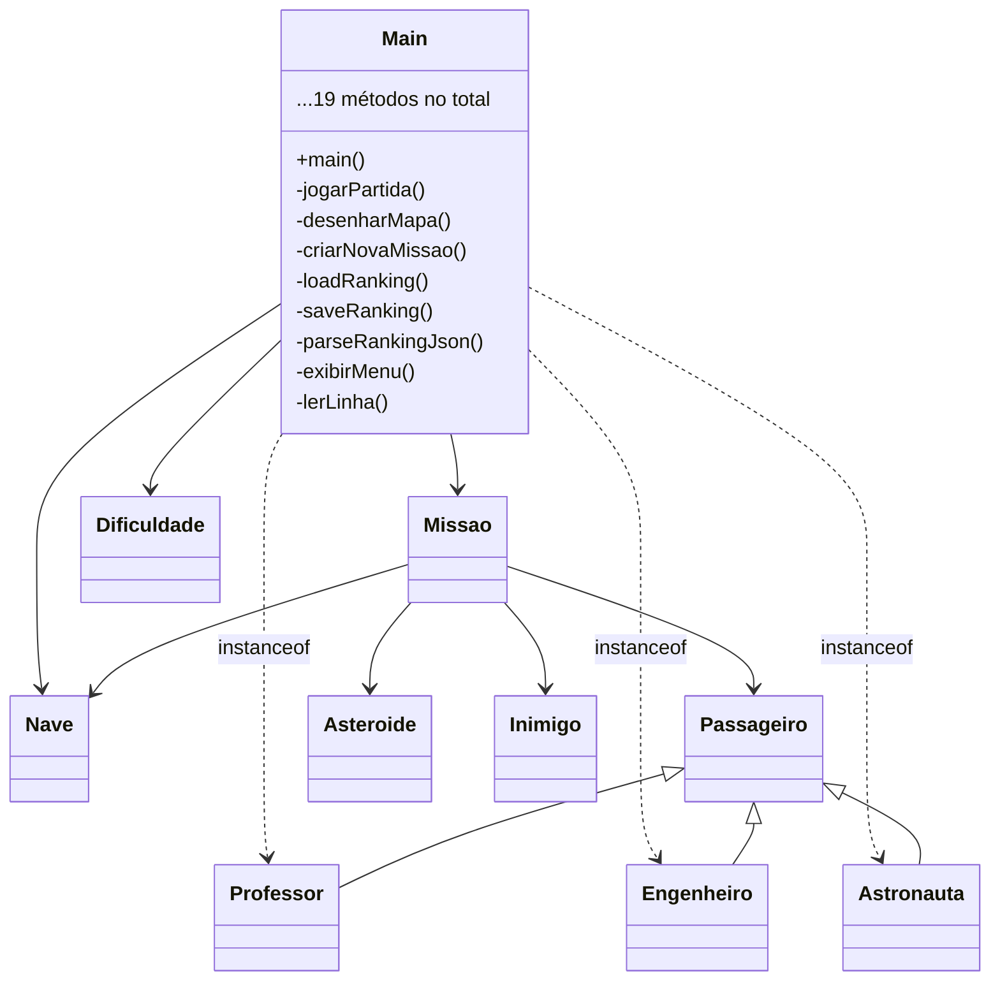
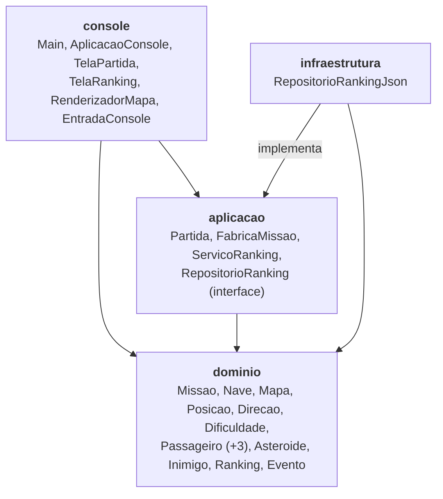
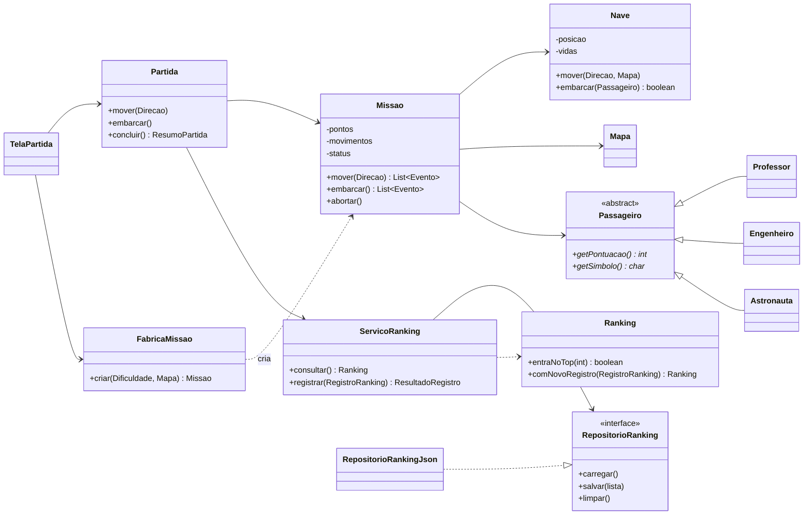
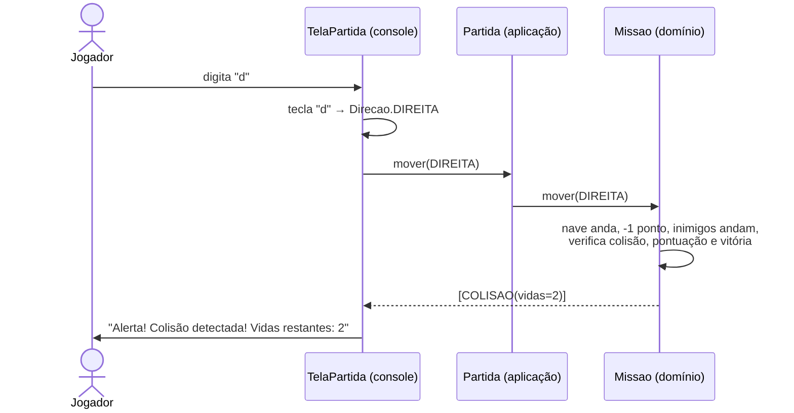

# Fase 1 — Arquitetura e refatoração

Este documento registra como o jogo funcionava na Fase 0, os problemas encontrados, a nova organização em camadas e as decisões tomadas. Os diagramas usam [Mermaid](https://mermaid.js.org/), que o GitHub desenha automaticamente.

## 1. Como o jogo funciona

O jogador pilota uma nave num mapa quadrado de `-N` a `+N` (N = tamanho escolhido, padrão 5). A missão é embarcar todos os passageiros e voltar à plataforma de pouso em `(0,0)`.

Fluxo de uma partida:

1. Menu → **1. Iniciar Nova Missão**.
2. O jogador informa nome, dificuldade e tamanho do mapa e pressiona Enter.
3. O jogo sorteia as posições de passageiros, asteroides e inimigos.
4. A cada turno: o mapa é desenhado, o jogador digita um comando e o jogo aplica as regras abaixo.
5. A partida termina em vitória, destruição da nave, pontuação zerada ou abandono (`q`).
6. Em caso de vitória, aparecem as estatísticas e, se a pontuação for boa o bastante, o piloto entra no Top 5 (`ranking.json`).

## 2. Regras de referência

Estas regras foram levantadas da Fase 0 antes da refatoração e servem de referência: a Fase 1 precisa respeitar todas.

| Regra | Valor |
| --- | --- |
| Pontuação inicial | Fácil 30, Médio 20, Difícil 45 |
| Passageiros / asteroides / inimigos | Fácil 4/1/1, Médio 5/2/2, Difícil 5/3/3 |
| Texto de dificuldade desconhecido | vira Médio |
| Tamanho de mapa inválido (texto ou ≤ 0) | usa 5 |
| Nave | começa em (0,0), 3 vidas, capacidade 5 |
| Movimento (`w`/`a`/`s`/`d`) | anda 1 casa, custa 1 ponto, conta 1 movimento; na borda do mapa a nave fica parada (mas paga o ponto) |
| Embarque (`c`) | não custa ponto; soma Professor 10, Engenheiro 15, Astronauta 20 |
| Comando inválido | mostra "Comando inválido." e não passa o turno |
| Depois de mover ou embarcar | cada inimigo anda 1 casa numa direção sorteada, sem sair do mapa |
| Colisão (nave na casa de asteroide ou inimigo) | perde 1 vida; com 0 vidas, "GAME OVER" |
| Pontuação ≤ 0 | "Missão perdida" |
| Vitória | todos os passageiros a bordo **e** nave em (0,0) |
| Ranking | só vitórias; entra se houver vaga (< 5) ou se superar o 5º colocado; guarda os 5 melhores |
| Passageiros sorteados | sempre na ordem Dr. Silva (P), Eng. Rosa (E), Dr. Lima (P), Eng. Carlos (E), Ast. Maria (T) |

## 3. Diagnóstico da Fase 0

| Problema | Onde | Consequência |
| --- | --- | --- |
| `Main` com 569 linhas faz tudo: menu, teclado, desenho, regras do turno, sorteio, ranking e JSON | `Main.java` | Nenhuma regra pode ser testada ou reaproveitada na versão gráfica sem levar junto `System.out` e `Scanner` |
| Pontuação, vidas e vitória são variáveis locais do laço da partida | `Main.jogarPartida` | As regras mais importantes do jogo não pertencem a nenhum objeto |
| Configuração da dificuldade em `switch`/`if` | `Main.definirPontuacaoInicial`, `Main.criarNovaMissao` | Para mudar uma dificuldade é preciso caçar valores no `Main` |
| Desenho do mapa usa `instanceof` para escolher a letra do passageiro | `Main.desenharMapa` | Um tipo novo de passageiro obriga a mudar o desenho |
| Limites do mapa passam como 4 inteiros soltos; comparação `x == x && y == y` repetida em ~10 lugares | várias classes | Código repetido e fácil de errar |
| `getPassageiros()` devolve a lista interna | `Nave`, `Missao` | Qualquer classe pode alterar o estado sem passar pelas regras |
| Ranking lido e gravado com manipulação de texto | `Main.parseRankingJson` | Nomes com vírgula quebram o arquivo |

## 4. Antes: Fase 0

Tudo depende do `Main`, e o `Main` depende de tudo, inclusive do console e do sistema de arquivos.

## 5. Depois: Fase 1

### Camadas

As setas apontam para quem é usado. O **domínio não depende de ninguém**: não conhece console, arquivo nem a aplicação. É essa parte que será reaproveitada pela versão libGDX (Fases 3 e 4) e pelo Android (Fase 6).

| Camada | Responsabilidade | Pode usar |
| --- | --- | --- |
| `dominio` | Regras do jogo e do ranking | só Java padrão |
| `aplicacao` | Casos de uso: montar a missão, conduzir a partida, registrar no ranking | domínio |
| `infraestrutura` | Detalhes técnicos: gravar o ranking em JSON | aplicação (interface) e domínio |
| `console` | Teclado e tela; monta todas as peças no `Main` | todas |

### Classes principais

### Um turno, passo a passo

O domínio devolve **eventos** (`COLISAO`, `PASSAGEIRO_EMBARCADO`, `MISSAO_CUMPRIDA`…) em vez de imprimir mensagens. Cada interface decide como mostrá-los: texto no console, som e animação na versão gráfica.

## 6. Princípios e padrões aplicados

| Princípio / padrão | Onde | Por quê |
| --- | --- | --- |
| **SRP** (responsabilidade única) | O antigo `Main` virou `TelaPartida`, `RenderizadorMapa`, `TelaRanking`, `Partida`, `FabricaMissao`, `ServicoRanking` e `RepositorioRankingJson` | Cada classe muda por um único motivo: mudar o desenho do mapa não afeta o ranking |
| **OCP** (aberto/fechado) | `Passageiro.getSimbolo()` / `getPontuacao()` | Um passageiro novo é uma subclasse nova; `RenderizadorMapa` não muda (antes usava `instanceof`) |
| **DIP** (inversão de dependência) | `ServicoRanking` depende da interface `RepositorioRanking` | Nos testes, o ranking usa um repositório em memória; na Fase 5, poderá usar o servidor |
| **GRASP Information Expert** | `Dificuldade` guarda a própria configuração; `Mapa` sabe se uma posição está dentro; `Missao` aplica as regras do turno | A regra fica com quem tem os dados |
| **GRASP Creator / Factory** | `FabricaMissao` | Concentra a montagem e o sorteio da missão |
| **GRASP Controller** | `Partida` | Recebe as ações do jogador e coordena missão, tempo e ranking |
| **Repository** | `RepositorioRanking` / `RepositorioRankingJson` | Esconde onde e como o ranking é guardado |
| **Composition root** | `console.Main` | Único lugar que cria as peças concretas e as liga |
| **Objeto de valor** | `Posicao` (record imutável) | Substitui pares `x, y` soltos e as comparações repetidas |
| **Encapsulamento** | listas devolvidas como somente leitura | Ninguém altera passageiros ou ranking sem passar pelas regras |

## 7. Mudanças intencionais de comportamento

A refatoração foi feita em dois commits: primeiro só a reorganização, **sem mudar nada**; depois as correções abaixo, num commit separado (`fix(fase1): ...`).

| Bug na Fase 0 | Correção na Fase 1 |
| --- | --- |
| O menu só aparecia **depois** que o jogador digitava algo: o programa esperava uma linha antes de mostrar as opções | O menu aparece primeiro e depois espera a opção |
| Nomes de piloto com vírgula, aspas ou `}` sumiam do ranking, porque o JSON era lido separando o texto por vírgulas | Leitor de JSON que respeita textos entre aspas e caracteres escapados |
| Mapa de tamanho 1 nas dificuldades Média e Difícil travava o jogo: há 9 casas para 10 ou 12 elementos, e o sorteio nunca terminava | Se não couber, o jogo avisa e usa o tamanho padrão (5) |
| A data do ranking era cortada com `substring(0, 19)`, que falha quando o horário cai exatamente no segundo :00 com 0 nanossegundos | Data formatada com `DateTimeFormatter` |

Outro efeito da primeira correção: uma linha vazia durante a partida agora redesenha o mapa. Antes, o jogo ficava esperando outra linha sem mostrar nada.

O formato do `ranking.json` não mudou: arquivos gravados pela Fase 0 são lidos pela Fase 1, e vice-versa.

## 8. Como verificamos que o comportamento foi preservado

1. **Comparação com a Fase 0.** As duas versões foram compiladas com o sorteio usando a mesma semente (`new Random(semente)`). Um jogador automático, que decide cada comando lendo o mapa impresso, jogou 80 sessões em cada versão: 320 partidas, com 273 vitórias, derrotas por colisão e por pontuação, embarques, recordes, Top 5, reset do ranking e entradas inválidas.
   - Após o commit de refatoração, as saídas foram **idênticas** nas 80 sessões.
   - Após o commit de correções, as saídas continuaram idênticas, exceto pelo momento em que o menu aparece.
2. **Testes automáticos** (`test/br/unifor/missaomarte/TestesRegras.java`): 25 testes das regras de domínio, aplicação e do `ranking.json`. Para conferir que os testes detectam erros, alteramos de propósito três regras (pontos do Professor, custo do movimento e regra de entrada no Top 5): em todos os casos, pelo menos um teste falhou.

## 9. Limitações e próximos passos

- Os testes ainda usam um mini-framework próprio; na **Fase 2** passam para JUnit 5 com Gradle.
- O console não tem testes automáticos; ele foi verificado pela comparação com a Fase 0.
- `Missao` recebe um `java.util.Random` para mover os inimigos. Isso é Java padrão e não prende o domínio a nenhuma interface, mas, se a Fase 7 trouxer inimigos com outros comportamentos, o movimento pode virar uma estratégia própria (padrão Strategy).
