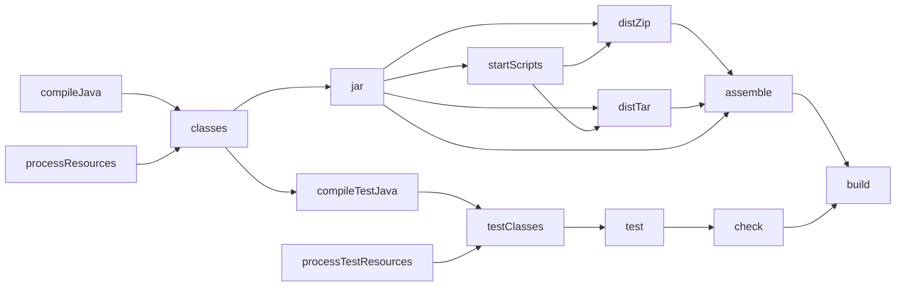

# Fase 2 — Tutorial da migração para Gradle

Este documento registra como o Missão Marte saiu de um build manual com `javac` para um projeto Gradle, quais conceitos do Gradle foram usados, como os testes foram organizados e como comprovamos que o jogo não mudou.

Todos os comandos citados aqui foram executados neste projeto. As saídas da seção 5 foram copiadas dessas execuções, com cortes marcados por `...`.

---

## 1. Estado de origem e destino

### 1.1 Como era (Fase 1)

- 31 arquivos `.java` em `fases/fase-1-refatoracao/src/br/unifor/missaomarte/`, separados nas camadas `dominio`, `aplicacao`, `infraestrutura` e `console`.
- Compilação manual, com o comando descrito no README da fase:
  ```bash
  javac -encoding UTF-8 -d out $(find src -name '*.java')
  java -cp out br.unifor.missaomarte.console.Main
  ```
- Nenhuma dependência declarada. A versão do Java dependia do que estivesse instalado em cada máquina.
- Testes num único arquivo, `test/br/unifor/missaomarte/TestesRegras.java`, com um "mini framework" próprio (métodos `igual`, `verdadeiro`, `lanca`) executado por um `main`.
- No IntelliJ, cada integrante tinha que marcar `src` e `test` como pastas de código à mão.

### 1.2 Como é agora (Fase 2)

```text
fase-2-gradle/
├── settings.gradle
├── build.gradle
├── gradlew, gradlew.bat
├── gradle/wrapper/gradle-wrapper.jar
├── gradle/wrapper/gradle-wrapper.properties
├── .gitignore
├── README.md
├── docs/tutorial.md
└── src/
    ├── main/java/br/unifor/missaomarte/{dominio,aplicacao,infraestrutura,console}
    └── test/java/br/unifor/missaomarte/{dominio,aplicacao,infraestrutura}
```

Um único comando (`./gradlew build`) baixa o Gradle certo, baixa o JUnit, compila, roda os 36 testes e gera o pacote do jogo. Ao abrir a pasta, IDEs como IntelliJ, VS Code e Eclipse reconhecem o projeto pelo `build.gradle`.

### 1.3 Equivalências

| Fase 1 | Fase 2 (Gradle) |
|---|---|
| `javac -encoding UTF-8 -d out ...` | `./gradlew compileJava` (ou `build`) |
| `java -cp out br.unifor.missaomarte.console.Main` | `./gradlew run --console=plain` |
| pasta `src/` | `src/main/java/` |
| pasta `test/` | `src/test/java/` |
| pasta `out/` | pasta `build/` (`build/classes`, `build/libs`, `build/reports`...) |
| `TestesRegras.java` com `main` | 10 classes JUnit 5 executadas por `./gradlew test` |
| "use o JDK 17" escrito no README | `sourceCompatibility`/`targetCompatibility` 17 no `build.gradle` |
| flag `-encoding UTF-8` no `javac` | `options.encoding = 'UTF-8'` em todas as tarefas `JavaCompile` |
| nenhum pacote para distribuir | `./gradlew installDist` / `distZip` geram scripts de execução |

---

## 2. Conceitos de Gradle aplicados

### 2.1 Tasks e o DAG de tarefas

No Gradle, todo trabalho é feito por uma **task** (compilar, testar, empacotar...). As tasks declaram de quais outras dependem, e o Gradle monta um **grafo dirigido acíclico (DAG)**. Cada task roda uma única vez, depois de todas as suas dependências.

Pedimos ao Gradle a lista de tasks que o `build` dispara, sem executá-las:

```text
$ ./gradlew build --dry-run
:compileJava SKIPPED
:processResources SKIPPED
:classes SKIPPED
:jar SKIPPED
:startScripts SKIPPED
:distTar SKIPPED
:distZip SKIPPED
:assemble SKIPPED
:compileTestJava SKIPPED
:processTestResources SKIPPED
:testClasses SKIPPED
:test SKIPPED
:check SKIPPED
:build SKIPPED
```

Esse grafo tem dois ramos que se encontram em `build`:



O Gradle também evita trabalho repetido. Rodando `./gradlew test` duas vezes seguidas, a segunda execução marca as tasks como `UP-TO-DATE`, porque nem fontes nem configuração mudaram. Para forçar a repetição usamos `--rerun-tasks`.

### 2.2 O plugin `application`

```groovy
plugins {
    id 'application'
}

application {
    mainClass = 'br.unifor.missaomarte.console.Main'
}
```

O plugin `application` aplica o plugin `java`, que traz `compileJava`, `test`, `jar`, `build` e outras. Além disso, ele adiciona:

| Task | O que faz |
|---|---|
| `run` | executa a `mainClass` com o classpath do projeto |
| `startScripts` | gera os scripts `bin/missao-marte` (Linux/macOS) e `bin/missao-marte.bat` (Windows) |
| `installDist` | monta `build/install/missao-marte/` com `bin/` e `lib/` |
| `distZip` / `distTar` | compactam essa mesma estrutura em `build/distributions/` |

A `mainClass` é `br.unifor.missaomarte.console.Main`, porque o `Main` da Fase 1 está no pacote `console`.

Outro ajuste foi necessário. O `run` não repassa o teclado ao programa por padrão, e sem isso o `Scanner(System.in)` do jogo não recebe nada (ver problema 3 na seção 3). Por isso configuramos:

```groovy
tasks.named('run') {
    standardInput = System.in
}
```

### 2.3 `implementation`, `testImplementation` e `testRuntimeOnly`

```groovy
dependencies {
    testImplementation 'org.junit.jupiter:junit-jupiter:5.10.2'
    testRuntimeOnly 'org.junit.platform:junit-platform-launcher'
}
```

| Configuração | Visível para compilar | Presente na execução | Uso |
|---|---|---|---|
| `implementation` | código principal (e testes) | jogo e testes | bibliotecas que o jogo usa. **O nosso jogo não tem nenhuma**, por isso essa configuração não aparece no arquivo |
| `testImplementation` | só os testes | só os testes | JUnit Jupiter (`@Test`, `assertEquals`, `@TempDir`, `@ParameterizedTest`) |
| `testRuntimeOnly` | ninguém | só na execução dos testes | o *launcher* que o Gradle usa para descobrir e rodar os testes |

Como o JUnit está em `testImplementation`, ele **não entra** no pacote do jogo. A pasta `build/install/missao-marte/lib/` contém só `missao-marte-2.0.jar`.

### 2.4 O Gradle Wrapper e por que ele é versionado

O wrapper é composto por `gradlew`, `gradlew.bat`, `gradle/wrapper/gradle-wrapper.jar` e `gradle/wrapper/gradle-wrapper.properties`. Ele é um pequeno programa que:

1. lê a versão fixada em `gradle-wrapper.properties`:
   ```properties
   distributionUrl=https\://services.gradle.org/distributions/gradle-8.7-bin.zip
   ```
2. baixa essa distribuição na primeira execução, guardando-a em `~/.gradle/wrapper/dists`;
3. executa o build com ela.

Ele é versionado no Git para que **todos os integrantes, o professor e qualquer máquina de CI usem exatamente a mesma versão do Gradle**, sem instalar nada além do JDK. Se cada pessoa usasse o Gradle instalado na própria máquina, o mesmo `build.gradle` poderia se comportar de forma diferente. Por isso o `.gitignore` da raiz do repositório comenta que o wrapper **deve** ser versionado.

### 2.5 Gradle instalado × Gradle do wrapper

| | Gradle instalado (`gradle`) | Gradle do wrapper (`./gradlew`) |
|---|---|---|
| Onde está | no `PATH` da máquina | baixado em `~/.gradle/wrapper/dists` |
| Versão | a que cada pessoa instalou | a fixada no projeto (8.7) |
| Quando usamos | **só uma vez**, para gerar o wrapper | em todos os comandos do dia a dia |

Na nossa máquina não havia Gradle instalado. Baixamos a distribuição 8.7 só para gerar o wrapper (ver problema 2 na seção 3). Depois disso, todos os comandos passaram a ser `./gradlew ...`.

### 2.6 Ciclo de vida do build

Todo build do Gradle passa por três fases:

1. **Inicialização**: lê o `settings.gradle` e descobre quais projetos participam do build. No nosso caso há um único projeto, `missao-marte` (`rootProject.name = 'missao-marte'`). Na Fase 3 este arquivo vai listar vários módulos.
2. **Configuração**: executa o `build.gradle`, aplica o plugin `application`, registra e configura as tasks (`java { ... }`, `tasks.withType(JavaCompile)...`, `tasks.named('test') {...}`) e monta o DAG.
3. **Execução**: roda só as tasks pedidas na linha de comando e suas dependências, pulando as que estão `UP-TO-DATE`.

Por isso usamos `tasks.named(...)` e `configureEach`: eles configuram a task apenas quando ela realmente vai ser usada (*configuração preguiçosa*).

---

## 3. Passo a passo da migração

Os passos estão na ordem em que foram feitos, incluindo os problemas que apareceram.

**1. Conferir o ambiente.** O Java padrão da máquina era o **OpenJDK 26**:

```text
$ java -version
openjdk version "26.0.2.1" 2026-08-18
```

> **Problema 1: Gradle 8.7 não roda no JDK 26.** Testamos rodar o Gradle 8.7 sobre esse JDK e o build falhou já na leitura do script:
> ```text
> FAILURE: Build failed with an exception.
> * What went wrong:
> BUG! exception in phase 'semantic analysis' in source unit '_BuildScript_' Unsupported class file major version 70
> ```
> "Major version 70" é o formato de classe do Java 26, que o Groovy embutido no Gradle 8.7 não reconhece.
> **Solução:** instalamos o **JDK 17 (Eclipse Temurin 17.0.21)** numa pasta própria e apontamos o `JAVA_HOME` para ele, só nos comandos do Gradle. O Java padrão da máquina não foi alterado:
> ```bash
> export JAVA_HOME=~/.jdks/temurin-17
> ```

**2. Gerar o wrapper.**

> **Problema 2: não havia Gradle instalado** para rodar `gradle wrapper`.
> **Solução:** baixamos a distribuição oficial `gradle-8.7-bin.zip` de `services.gradle.org`, conferimos o SHA-256 publicado (`544c35d6...b961d`, igual ao do site) e usamos esse Gradle uma única vez:
> ```bash
> gradle wrapper --gradle-version 8.7
> ```
> Isso criou `gradlew`, `gradlew.bat` e `gradle/wrapper/`. A partir daí usamos sempre `./gradlew`.

**3. Criar `settings.gradle` e `build.gradle`.** Requisitos atendidos:

| Requisito | Onde está no `build.gradle` |
|---|---|
| plugin `application` e `mainClass` | `plugins { id 'application' }` e `application { mainClass = ... }` |
| Java 17 (origem e destino) | `java { sourceCompatibility/targetCompatibility = JavaVersion.VERSION_17 }` |
| UTF-8 em toda compilação | `tasks.withType(JavaCompile).configureEach { options.encoding = 'UTF-8' }` |
| só `mavenCentral()` | `repositories { mavenCentral() }` |
| teclado no `run` | `tasks.named('run') { standardInput = System.in }` |
| JUnit 5 + launcher | `dependencies { ... }` e `useJUnitPlatform()` |
| jogo sem dependências de execução | nenhuma linha `implementation` |

Também adicionamos `testLogging` (desafio opcional 2), que mostra no console o resultado de cada teste.

**4. Copiar os fontes sem alterar.** Copiamos `fase-1-refatoracao/src/br` para `src/main/java/br`. Nenhum arquivo foi editado. A conferência por hash está na seção 5.6.

> **Problema 3: sem `standardInput`, o jogo não recebe o teclado.** Para registrar o comportamento, rodamos uma cópia descartável do projeto sem a configuração do `run`, digitando `1` no menu. O jogo leu "fim da entrada" na primeira pergunta e encerrou:
> ```text
> Escolha uma opção:
> Entrada encerrada. Obrigado por jogar!
> ```
> O `Scanner` recebeu um `System.in` vazio, porque o processo que o Gradle cria não está ligado ao terminal. Com `standardInput = System.in`, o menu e os comandos `w/a/s/d/c/q` funcionam normalmente (seção 5.4).

**5. Migrar os testes para JUnit 5.** Os 25 cenários do `TestesRegras` viraram métodos `@Test` com `assertEquals`, `assertTrue` e `assertThrows`. Eles foram distribuídos em uma classe por classe testada, **no mesmo pacote** do código, e foram acrescentados os casos que o enunciado pede (seção 4).

> **Problema 4: `Acao` não existe no nosso projeto.** O enunciado pede testes da classe `Acao` (texto digitado → ação). No nosso código, essa conversão fica no método `private static direcaoDaTecla(char)` de `console/TelaPartida`. Testá-lo exigiria mudar a visibilidade ou extrair uma classe, o que alteraria o código do jogo e é proibido nesta fase. **Ficou registrado como limitação** (seção 6) e proposto para a Fase 3.

> **Problema 5: testes do ranking escrevendo na pasta do usuário.** Na Fase 1, os testes do `RepositorioRankingJson` criavam arquivos com `Files.createTempFile` e precisavam de `try/finally` para apagá-los. Na Fase 2 usamos `@TempDir`: o JUnit cria uma pasta temporária para cada teste e a apaga no final, mesmo se o teste falhar.

**6. Criar o `.gitignore` da fase** com `.gradle/`, `build/`, `out/` e `ranking.json`.

**7. Validar** com o roteiro da seção 5.

---

## 4. Testes

### 4.1 O que cada classe cobre

Os testes ficam em `src/test/java`, no mesmo pacote da classe testada. Nenhum depende do teclado, e nenhum grava arquivos fora de pasta temporária.

| Classe de teste | Classe testada | Equivalente no enunciado | Testes | O que verifica |
|---|---|---|---|---|
| `dominio/PosicaoTest` | `Posicao` | `Posicao` | 3 | mover devolve **nova** instância sem alterar a original; cada direção anda uma casa (y cresce para baixo); `equals`/`hashCode` por coordenadas |
| `dominio/NaveTest` | `Nave` | `Nave` | 5 | estado inicial; embarque até a capacidade e recusa com **nave cheia**; lista de passageiros somente leitura; não sai do mapa; vidas não ficam negativas |
| `dominio/MissaoTest` | `Missao` | `GameSession` | 8 | custo de 1 ponto por movimento; embarque soma o bônus do tipo; embarque sem passageiro; nave cheia; **colisão** tira vida e a 3ª destrói; pontuação zerada; **vitória** só na plataforma com todos a bordo; ações recusadas após o fim |
| `dominio/DificuldadeTest` | `Dificuldade` | — | 2 | pontos e quantidades por dificuldade; conversão de texto com/sem acento e padrão Médio |
| `dominio/InimigoTest` | `Inimigo` | — | 1 | 500 passos aleatórios sem sair do mapa |
| `dominio/RankingTest` | `Ranking` | — | 2 | ordena e guarda só o Top 5; regra de entrada (zero nunca entra, empate com o último não entra) |
| `aplicacao/FabricaMissaoTest` | `FabricaMissao` | `MissaoFactory` | 6 | quantidades por dificuldade (`@ParameterizedTest` com `@EnumSource`, 3 execuções); **nenhum objeto na mesma célula** nem na plataforma (200 sementes); mesma semente gera o mesmo mapa; mapa pequeno demais é recusado |
| `aplicacao/PartidaTest` | `Partida` | `GameSession` | 3 | partida cumprida gera resumo e entra no ranking (com `Clock` fixo); colisão durante a partida; missão abortada não pode ser concluída e não grava ranking |
| `aplicacao/ServicoRankingTest` | `ServicoRanking` | — | 2 | só grava quem entra no Top 5; falha ao salvar é informada sem perder a vaga |
| `infraestrutura/RepositorioRankingJsonTest` | `RepositorioRankingJson` | `FileRankingRepository` | 4 | gravar e ler (nomes com vírgula, aspas, chaves e barra); arquivo ausente ou cortado vira ranking vazio; JSON da Fase 0 continua legível; `limpar` apaga o arquivo. Tudo com `@TempDir` |
| **Total** | | | **36** | |

Apoio aos testes (não são testes):

- `DadosDeTeste`: cria uma missão vazia e um registro de ranking padrão, usados por várias classes.
- `aplicacao/RepositorioRankingEmMemoria`: repositório falso em memória. Mostra que `ServicoRanking` e `Partida` dependem da **interface** `RepositorioRanking`, e não do arquivo JSON (inversão de dependência).

### 4.2 Resultado

```text
$ ./gradlew test --console=plain --rerun-tasks
...
FabricaMissaoTest > respeitaAsQuantidadesDaDificuldade(Dificuldade) > [1] FACIL PASSED
FabricaMissaoTest > respeitaAsQuantidadesDaDificuldade(Dificuldade) > [2] MEDIO PASSED
FabricaMissaoTest > respeitaAsQuantidadesDaDificuldade(Dificuldade) > [3] DIFICIL PASSED
...
MissaoTest > cadaColisaoTiraUmaVidaEATerceiraDestroiANave() PASSED
...
RepositorioRankingJsonTest > gravaELeNomesComVirgulaAspasEChaves() PASSED

BUILD SUCCESSFUL in 3s
3 actionable tasks: 3 executed
```

Somando os relatórios XML de `build/test-results/test/` (10 arquivos, um por classe): **36 testes, 0 ignorados, 0 falhas, 0 erros**.

### 4.3 Relatório HTML

Depois de `./gradlew test`, abra no navegador:

```text
build/reports/tests/test/index.html
```

A página mostra o total de testes, a taxa de sucesso e o tempo. Dá para navegar por pacote (`dominio`, `aplicacao`, `infraestrutura`) e por classe. Quando um teste falha, a página da classe mostra a mensagem do `assert` e a pilha de chamadas. Os mesmos dados ficam em XML em `build/test-results/test/`, formato que ferramentas de CI conseguem ler.

---

## 5. Evidências de validação

Executado em Linux, com `JAVA_HOME` apontando para o JDK 17 e na pasta `fases/fase-2-gradle`.

### 5.1 Versão

```text
$ ./gradlew --version
Gradle 8.7
Kotlin:       1.9.22
JVM:          17.0.21.1 (Eclipse Adoptium 17.0.21.1+2)
OS:           Linux 7.0.0-43-generic amd64
```

### 5.2 Build completo

```text
$ ./gradlew clean build --console=plain
...
BUILD SUCCESSFUL in 4s
8 actionable tasks: 7 executed, 1 up-to-date
```

### 5.3 Testes

36 testes, todos aprovados (seção 4.2).

### 5.4 Jogo pelo `gradlew run`, nas três dificuldades

Jogamos `./gradlew run --console=plain` com o menu, uma partida em cada dificuldade (Fácil, Médio e Difícil, mapa tamanho 5) e a saída pelo menu. Para conseguir uma vitória em cada dificuldade de forma repetível, a entrada foi digitada por um script auxiliar que lê o mapa impresso e escolhe o caminho. O jogo recebeu essa entrada pelo mesmo `standardInput` do teclado. Trechos da saída:

```text
================================================================
             MISSÃO MARTE UNIFOR - VERSÃO 10.0
================================================================
...
Iniciando missão na dificuldade Fácil...
Pressione Enter para decolar!

Mapa da Missão (Pontos: 30) - Piloto: Robo facil
...
🚀 DECOLAGEM AUTORIZADA! Nave acoplada à plataforma em (0,0).
Retornando à órbita marciana com todos os passageiros. Missão cumprida!
================================================================
Estatísticas da Partida:
 - Pontuação Final: 42 pontos
 - Movimentos Efetuados: 38
 - Tempo de Jogo: 41 segundos
 - Passageiros Resgatados: 4
================================================================
Parabéns! Você entrou para o Top 5 de pilotos!
...
Escolha uma opção: 2
====== RANKING TOP 5 PILOTOS ======
1. Robo dificil - 93 pts | Dificuldade: Difícil | Coletados: 5 | Tempo: 27s | 2026-11-23 15:42:15
2. Robo medio - 56 pts | Dificuldade: Médio | Coletados: 5 | Tempo: 39s | 2026-11-23 15:41:47
3. Robo facil - 42 pts | Dificuldade: Fácil | Coletados: 4 | Tempo: 41s | 2026-11-23 15:41:07
===================================
...
Escolha uma opção: 4
Obrigado por jogar a Missão Marte Unifor!
```

### 5.5 Ranking gravado na pasta da Fase 2

```text
$ ls ranking.json
ranking.json
$ cat ranking.json
[{"name":"Robo dificil","score":93,"dificuldade":"DIFICIL","passageirosColetados":5,"dataHora":"2026-11-23 15:42:15","tempoJogo":27},{"name":"Robo medio",...},{"name":"Robo facil",...}]
```

### 5.6 Fontes idênticos aos da Fase 1

Geramos o SHA-256 de cada `.java` da Fase 1 e conferimos contra `src/main/java`:

```bash
cd ../fase-1-refatoracao/src && find . -name '*.java' | sort | xargs sha256sum > /tmp/fase1.sha
cd ../../fase-2-gradle/src/main/java && sha256sum -c /tmp/fase1.sha
```

```text
./br/unifor/missaomarte/aplicacao/FabricaMissao.java: SUCESSO
...
./br/unifor/missaomarte/dominio/TipoEvento.java: SUCESSO
./br/unifor/missaomarte/infraestrutura/RepositorioRankingJson.java: SUCESSO
```

**31 de 31 arquivos idênticos.** `diff -r` entre as duas pastas também não mostrou nenhuma diferença. No Windows, o equivalente é `Get-FileHash`.

### 5.7 Build a partir do estado limpo

```text
$ rm -rf build .gradle
$ ./gradlew clean build --console=plain
BUILD SUCCESSFUL in 4s
8 actionable tasks: 7 executed, 1 up-to-date
```

### 5.8 `installDist` e `distZip`

```text
$ ./gradlew installDist
BUILD SUCCESSFUL in 1s
$ find build/install
build/install/missao-marte/bin/missao-marte
build/install/missao-marte/bin/missao-marte.bat
build/install/missao-marte/lib/missao-marte-2.0.jar
```

Desafio opcional 3: geramos o `distZip`, extraímos `build/distributions/missao-marte-2.0.zip` em **outra pasta** e executamos `missao-marte-2.0/bin/missao-marte` de lá. O jogo abriu normalmente e mostrou `Nenhum registro encontrado` no ranking, porque o `ranking.json` é lido da pasta de execução, e não da pasta do projeto.

### 5.9 Fases anteriores intactas

`git status` não mostra nenhuma alteração em `fases/fase-0-inicial` nem em `fases/fase-1-refatoracao`.

---

## 6. Limitações e próximos passos

1. **Projeto de módulo único.** Domínio, aplicação, infraestrutura e console estão no mesmo módulo Gradle, e nada impede o `dominio` de importar algo do `console`. A Fase 3 exige que o domínio não dependa do libGDX. A solução natural é um build **multi-módulo** (`core` com domínio e aplicação, `desktop` com libGDX e `console`), em que o Gradle passa a garantir essas fronteiras: um módulo só enxerga o que declara em `dependencies`.
2. **Conversão de teclas sem teste.** `direcaoDaTecla` é privada em `TelaPartida` (problema 4). Para a Fase 3, propomos extraí-la para uma classe de entrada independente de interface, como um `Acao`/`Comando` que transforma tecla em ação. Assim ela pode ser testada e reaproveitada pelo teclado do libGDX e pelos botões de toque do Android.
3. **Telas de console sem testes automáticos.** `AplicacaoConsole`, `TelaPartida`, `TelaRanking` e `RenderizadorMapa` escrevem direto em `System.out` e leem de `Scanner`. Por isso a validação do console foi feita jogando (seção 5.4). Na Fase 3 essas telas serão substituídas pela interface gráfica, então não vale a pena investir em testá-las agora.
4. **`Main` cria `new Random()` sem semente.** Não é possível reproduzir uma partida específica pela linha de comando. Uma opção futura é aceitar a semente como argumento (`./gradlew run --args="--semente 42"`).
5. **Persistência em arquivo local.** O `ranking.json` depende da pasta de execução (seção 5.8) e não é compartilhado entre jogadores. A Fase 5 substitui isso pelo servidor de ranking em Spring Boot.
6. **Ambiente.** O Gradle 8.7 exige um JDK entre 8 e 21 para rodar. Quem tiver só um JDK mais novo como padrão vai cair no problema 1. A Fase 3 pode avaliar uma *toolchain* do Gradle (`java { toolchain { languageVersion = JavaLanguageVersion.of(17) } }`) para reduzir esse risco, desde que o libGDX 1.12.1 seja compatível com ela.
